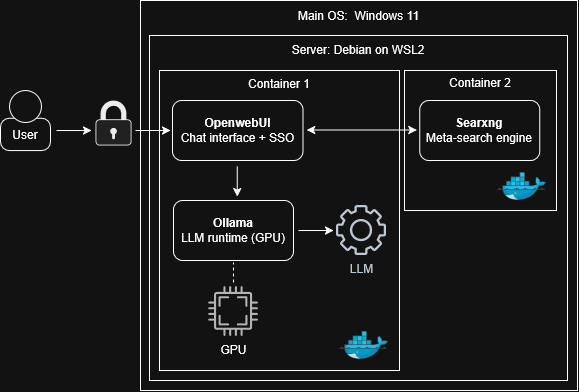

# Self hosted AI stack

This project deploys a self hosted AI stack using Ollama and OpenwebUI.

## Overview

This project has been developed in order to learn how to deploy a self hosted AI stack, for free. It runs Ollama and OpenwebUI on a low budget workstation for LAN use.

The stack is described as follows:



The workstation specs are:

* CPU: AMD Ryzen 5 5600X
* RAM: 32Gb DDR4 3200MHz
* GPU: Nvidia Geforce RTX 5070 12Gb
* Storage: 1.5Tb SSD

## Getting started

### Prerequisites

Install WSL2 from Windows Powershell:

```powershell
# Enable VM platform and WSL
dism.exe /online /enable-feature /featurename:VirtualMachinePlatform /all /norestart
dism.exe /online /enable-feature /featurename:Microsoft-Windows-Subsystem-Linux /all /norestart

# Set WSL to version 2 and install Debian
wsl --set-default-version 2
wsl --install Debian

# Start the WSL2 server
wsl -d Debian
```

### Dependencies and tools

Install the following packages from Debian terminal (WSL2):

```bash
# Fetch and update packages
sudo apt update && sudo apt upgrade

# Install selected packages
sudo apt install ca-certificates curl gnupg2 make net-tools vim wget zip zstd
```

### Installing Docker

Still from Debian terminal (WSL2):

```bash
# Set up a dedicated keyring directory
sudo install -m 0755 -d /etc/apt/keyrings

# Download and store Docker GPG keys
curl -fsSL https://download.docker.com/linux/debian/gpg -o /etc/apt/keyrings/docker.asc
chmod a+r /etc/apt/keyrings/docker.asc

# Define Docker packages location and GPG key to use
sudo tee /etc/apt/sources.list.d/docker.sources <<EOF
Types: deb
URIs: https://download.docker.com/linux/debian
Suites: $(. /etc/os-release && echo "$VERSION_CODENAME")
Components: stable
Architectures: $(dpkg --print-architecture)
Signed-By: /etc/apt/keyrings/docker.asc
EOF

# Fetch packages and install Docker
sudo apt update
sudo apt install docker-ce docker-ce-cli containerd.io docker-buildx-plugin docker-compose-plugin

# Enable and test Docker installation
sudo systemctl enable docker
sudo docker run hello-world
```

### Enabling Nvidia GPU support (CDI)

Once again from Debian terminal (WSL2):

```bash
# Download and store Nvidia container toolkit GPG keys
curl -fsSL https://nvidia.github.io/libnvidia-container/gpgkey | sudo gpg --dearmor -o /usr/share/keyrings/nvidia-container-toolkit-keyring.gpg

# Define Nvidia container toolkit location and GPG key to use
curl -s -L https://nvidia.github.io/libnvidia-container/stable/deb/nvidia-container-toolkit.list | sed 's#deb https://#deb [signed-by=/usr/share/keyrings/nvidia-container-toolkit-keyring.gpg] https://#g' | sudo tee /etc/apt/sources.list.d/nvidia-container-toolkit.list

# Fetch packages and install Nvidia container toolkit
sudo apt update
sudo apt install nvidia-container-toolkit

# Configure Nvidia Container Toolkit for Docker
sudo nvidia-ctk runtime configure --runtime=docker

# Restart Docker and list Nvidia devices
sudo systemctl restart docker
nvidia-ctk cdi list
```

## Deploying first container

### Installing Ollama

From Debian terminal (WSL2):

```bash
# Download and install Ollama
curl -fsSL https://ollama.com/install.sh | sh

# Check if Ollama is running on port 11434
curl 127.0.0.1:11434
```

Setup remote access to LAN by adding `OLLAMA_HOST=127.0.0.1:11434` to Windows environment variables. Shutdown WSL2 using `wsl --shutdown` then restart Windows.

Start WSL2 using `wsl` then gather ethernet interface IPv4 address using `ifconfig eth0` from Debian terminal.

From Windows Powershell:

```powershell
# Enable forwarding on port 8080
netsh interface portproxy add v4tov4 listenport=8080 listenaddress=0.0.0.0 connectport=8080 connectaddress=<IPv4_address>

# Add an inbound firewall rule for port 8080
New-NetFirewallRule -DisplayName "OpenwebUI" -Direction Inbound -Action Allow -Protocol TCP -LocalPort 8080
```

### Installing OpenwebUI and so on

Back to Debian terminal (WSL2):

```bash
# Install OpenwebUI and deploy the container
cd ollama-webui && sudo docker compose up -d
```

## Deploying second container

### Installing Searxng

Still from Debian terminal (WSL2):

```bash
# Deploy Searxng search proxy on port 8888
cd ../searxng && sudo docker compose up -d
```

### Configuring OpenwebUI

Connect to [OpenwebUI](http://localhost:8080) then set up the admin account.

Enable the web search feature in the admin settings with the following configuration:

* Settings --> Web Search:
  * Enable Web Search
  * Web Search engine: `searxng`
  * Searxng Query URL: `http://<IPv4_address>:8888/search` (gathered with `ifconfig eth0`)
  * Enable Bypass Embedding and Retrieval
  * Enable Bypass Web Loader
* Settings --> Models --> Edit --> Advanced params:
  * Disable `think (Ollama)` for small models
  * Set `num_ctx (Ollama)` to a minimum of 16,384 tokens

## Pulling models

### From Ollama

From Debian terminal (WSL2):

```bash
# Pull the desired model
ollama pull <model_name>
```

Tested `qwen3.5:9b` and `gemma4:12b` from [Ollama models](https://ollama.com/search).

### From HuggingFace (GGUF)

Still from Debian terminal (WSL2):

```bash
# Install Python and create virtual environment
sudo apt install python3 python3-dev python3-pip python3-venv
python3 -m venv hf_models

# Load the virtual environment and install HuggingFace hub
source hf_models/bin/activate
pip3 install huggingface_hub

# Create models directory
mkdir ollama_models && cd ollama_models

# Pull the desired model
mkdir <model_name> && cd <model_name>
hf download <model_repository> --include "<gguf_file>.gguf" --local-dir .
ollama create <model_name>

# Exit the virtual environment
deactivate
```

Tested `yuxinlu1/gemma-4-12B-it-Claude-4.6-4.8-Opus-GGUF` with both `gemma4-opus48-Q4_K_M.gguf` and `gemma4-opus48-Q6_K.gguf` from [HuggingFace models](https://huggingface.co/models?library=gguf).

## Conclusion

Everything should work out of the box, pulled models appear immediatly on OpenwebUI. See [Ollama](https://docs.ollama.com/index) and [OpenwebUI](https://docs.openwebui.com/getting-started/) documentation for further configuration.

Licence: [Apache 2.0](https://www.apache.org/licenses/LICENSE-2.0).